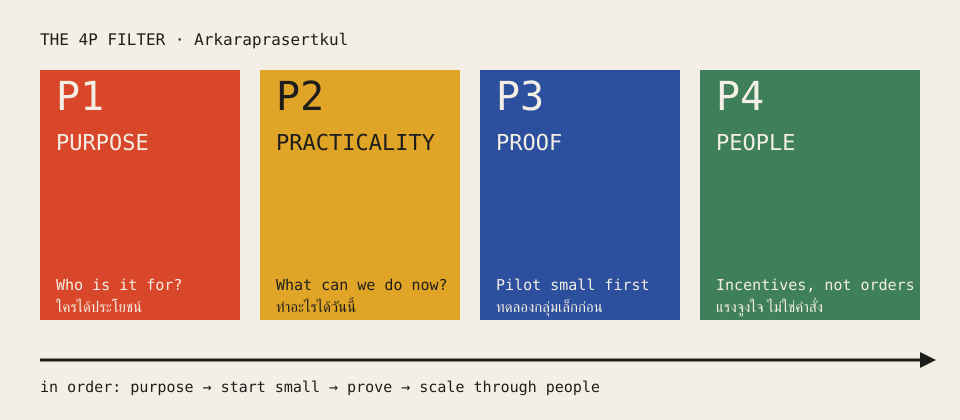

<section lang="en" id="en">

# The 4P Filter: Why Smart-City Projects Fail and How to Catch Them Early

**Non Arkaraprasertkul, PhD** · Thailand's ASCN representative since 2019 · ASCN Working Papers, No. 1 · October 2026 · Draft

**Abstract.** Cities in ASEAN do not fail at "smart" because they lack technology or money. They fail because they buy before they ask what the system is for, who it serves, and whether it works at small scale. In this paper I set out the 4P filter I use in my own practice and teaching: Purpose, Practicality, Proof and People. I describe each P in plain words, show where it comes from in my recorded talks, and give a short checklist that a city officer can use before writing a terms of reference (TOR). This is a practitioner's paper, not a controlled study. Its claims are about method, not measured impact.

**Keywords:** smart cities; ASEAN Smart Cities Network; public-sector innovation; pilots; incentives; Thailand

## 1. The problem: good intentions, wrong product

I have worked inside Thailand's smart-city system for years, and I keep seeing the same pattern. A well-funded, well-meaning project gets built, launched with a ribbon-cutting and then goes quiet within months.

In a September 2026 talk on AI in government, I named four blockers and called them the "ABCD" of digital projects. **A** is affordability: new technology is expensive. **B** is bureaucracy: systems take a long time to build and longer to get approved. **C** is capacity: "you have the systems, but you don't have anyone who can actually use the system." **D** is design: data sits in separate systems that are "completely useless" when you look at them alone (Arkaraprasertkul, 2026b).

I use a simple picture for this. Parents buy toys for a baby while looking down from above. The baby sees the toy from below and wants something else. Mayors, ministries and vendors are often the parents; citizens are the baby. In my words, the purpose "has to be about the babies down there and not about the parents, because sometimes the parent … never [has] been sleeping on the bed before" (Arkaraprasertkul, 2026b).

The 4P filter is how I try to catch that mismatch before money turns into concrete and contracts.

*Figure 1. The 4P filter, read left to right. Original diagram by the author.*

## 2. P1 — Purpose

Purpose is not a mission statement. It is the specific outcome the system exists to deliver for citizens.

"Install 300 cameras" is not a purpose. "Shorter trips home", "cleaner air so fewer people go to hospital" or "students who learn faster" are purposes. In my talk I put it simply: "If the purpose is to sell to make money, maybe it's not going to last very long" (Arkaraprasertkul, 2026b).

**Test:** write the purpose as one sentence about a citizen. If the sentence names a vendor or a gadget, rewrite it.

## 3. P2 — Practicality

Practicality means asking what you can do now, with what you already have.

Projects fail when they start big. "When you think big from the start, you start with … 100 million dollars. You're not gonna go anywhere for the next 10 years" (Arkaraprasertkul, 2026b). I spend most of my time doing rather than planning, because "if you only think but not doing, nothing gonna happen" (Arkaraprasertkul, 2026b).

The same idea shows up in my flood work. In a 2026 UN resilience workshop I said the integration demo ran on "my second hand laptop with eight [GB of] RAM," and that the point is "not about advancement of technologies. It's about integration" (Arkaraprasertkul, 2026a).

**Test:** list the data and tools you already have. Build from those before you buy anything new.

## 4. P3 — Proof

Proof means a pilot before you scale, no matter how confident you are.

"If I want to do a project for 1 million people, maybe I don't do it for 1 million people right away. Maybe I start with … 1,000 people first" (Arkaraprasertkul, 2026b). If the pilot fails, you have learned cheaply. I call that failing forward. If you skip the pilot and fail at full scale, "you fail backward. And sometimes … you couldn't get up ever again" (Arkaraprasertkul, 2026b).

**Test:** define the smallest group that could prove the idea wrong, and run it there first.

## 5. P4 — People

People do not use a system because they are told to.

"People are not driven by instructions. We don't like to be commanded … But we enjoy being told what are the incentives" (Arkaraprasertkul, 2026b). So design the system so that using it is in people's own interest: staff who get recognised for fixing problems, mayors who see what voters care about, citizens who get a faster answer.

**Test:** name who gains time, money, status or safety when the system works. If nobody does, expect nobody to use it.

## 6. What the filter looks like in practice

Two figures from my recorded talks show what the filter can look like when a city runs the loop.

In talks on the 4P framework I describe a citizen photo-reporting path used in Nakhon Si Thammarat: residents send a photo, staff are dispatched to clear the blockage, and citizens rate the fix with stars that feed into promotion decisions. Under that star-incentive scheme, average staff resolution time fell from about **184 hours to 42 hours** (Arkaraprasertkul, 2026b; working note on the 4P lectures, 2023–2026). The same city later appeared on the international circuit as a **World Smart City Award** case in **2023** (working note on the 4P lectures, 2023–2026).

**Methods note on these figures.** Both numbers and the award title come from my own recorded talks and from a working note that collects the 4P idea across my 2023–2026 lectures. They are practitioner reports, not yet attached to a public monitoring-and-evaluation table or an organiser award listing in this paper. Readers should treat them as claims from the author's archive until a public citation is added.

## 7. A checklist before the TOR

1. Write the purpose as one sentence about a citizen.
2. List the data and tools you already have.
3. Define a small pilot that could prove you wrong.
4. Name the incentive for each user group.
5. Show a working slice in one meeting before asking for a budget.

## 8. Why this matters for ASCN

The ASEAN Smart Cities Network links cities with very different budgets and capacities. A filter that starts from purpose and small proof travels better across that range than a shopping list of technologies. It also fits the direction of UN-Habitat's work on people-centred smart cities, which asks that digital infrastructure serve people and human rights (UN-Habitat, n.d.).

## 9. Methods and sources

This paper is built from my own recorded talks, transcribed by Otter.ai and lightly cleaned for grammar (filler words and repetitions removed; meaning unchanged; omissions marked "…" and insertions in square brackets). The main source is a 48-minute talk on AI and digital solutions for government recorded on 14 September 2026 (*AI digital solutions and the 4P framework*). A working note that collects the 4P idea across my 2023–2026 lectures was used to cross-check wording and to recover city figures (the 184→42 hour resolution path and the 2023 Nakhon Si Thammarat award) that I routinely cite in those talks.

## 10. Limitations

This is a practitioner framework, not a tested model. I report no effect sizes from a controlled study. The city figures in §6 (184→42 hours; Nakhon Si Thammarat's 2023 award) come from my recorded talks and the 4P working note; a public third-party citation is still pending, as noted in that section. Readers who want to test the 4P filter should treat it as a hypothesis about project design.

## References

Arkaraprasertkul, N. (2026a, April 1). *UN project on resiliency workshop* [Recorded meeting remarks; Otter.ai transcript]. Author's archive.

Arkaraprasertkul, N. (2026b, September 14). *AI digital solutions and the 4P framework* [Recorded talk; Otter.ai transcript]. Author's archive.

Arkaraprasertkul, N. (n.d.). *The 4P framework — smart city methodology* [Working note collecting 2023–2026 lecture material]. Author's archive.

UN-Habitat. (n.d.). *International guidelines on people-centred smart cities*. Retrieved October 15, 2026, from https://unhabitat.org/international-guidelines-on-people-centred-smart-cities

## Credits

Figure 1: original diagram by the author, drawn in the Palette design system. Photograph on the HTML page: David Broad, "Bangkok canals Khlongs in the Thon Buri district" (2007), Wikimedia Commons, CC BY 3.0, https://commons.wikimedia.org/wiki/File:Bangkok_canals_Khlongs_in_the_Thon_Buri_district_-_panoramio_(3).jpg

</section>

<section lang="th" id="th">

# ตัวกรอง 4P: ทำไมโครงการเมืองอัจฉริยะจึงล้มเหลว และจะจับให้ได้ตั้งแต่ต้นอย่างไร

**ดร.นน อัครประเสริฐกุล** · ผู้แทนประเทศไทยใน ASCN ตั้งแต่ปี 2562 · ASCN Working Papers ฉบับที่ 1 · ตุลาคม 2569 · ฉบับร่าง

**บทคัดย่อ** เมืองในอาเซียนไม่ได้ล้มเหลวเรื่อง "เมืองอัจฉริยะ" เพราะขาดเทคโนโลยีหรือขาดเงิน แต่ล้มเหลวเพราะซื้อของก่อนจะถามว่าระบบนี้มีไว้ทำอะไร ทำเพื่อใคร และใช้ได้จริงในกลุ่มเล็กหรือไม่ บทความนี้อธิบายตัวกรอง 4P ที่ผมใช้ทั้งในการทำงานและการสอน คือ Purpose (เป้าหมาย) Practicality (ทำได้จริง) Proof (พิสูจน์ก่อน) และ People (คน) ผมอธิบายแต่ละข้อด้วยภาษาง่าย ๆ อ้างอิงจากการบรรยายที่บันทึกไว้ และให้รายการตรวจสอบสั้น ๆ ที่เจ้าหน้าที่เมืองใช้ได้ก่อนเขียน TOR บทความนี้เขียนจากประสบการณ์ภาคปฏิบัติ ไม่ใช่งานวิจัยเชิงทดลอง ข้อเสนอจึงเป็นเรื่องวิธีคิด ไม่ใช่ผลกระทบที่วัดได้

**คำสำคัญ:** เมืองอัจฉริยะ; เครือข่ายเมืองอัจฉริยะอาเซียน (ASCN); นวัตกรรมภาครัฐ; โครงการนำร่อง; แรงจูงใจ; ประเทศไทย

## 1. ปัญหา: ตั้งใจดี แต่ได้ของผิด

ผมทำงานในระบบเมืองอัจฉริยะของไทยมาหลายปี และเห็นรูปแบบเดิมซ้ำ ๆ โครงการที่มีงบและตั้งใจดีถูกสร้างขึ้น ตัดริบบิ้นเปิดตัว แล้วก็เงียบหายไปในไม่กี่เดือน

ในการบรรยายเรื่อง AI กับภาครัฐเมื่อกันยายน 2569 ผมสรุปอุปสรรคไว้สี่ข้อ เรียกว่า "ABCD" **A** คือค่าใช้จ่าย เทคโนโลยีใหม่มักแพง **B** คือระบบราชการ สร้างระบบก็นาน ขออนุมัติยิ่งนาน **C** คือขีดความสามารถ มีระบบแล้วแต่ไม่มีคนใช้เป็น **D** คือการออกแบบ ข้อมูลแยกกันอยู่หลายระบบ ดูทีละระบบแล้วแทบไม่มีประโยชน์ (Arkaraprasertkul, 2026b)

ผมชอบเปรียบเทียบแบบนี้ พ่อแม่ซื้อของเล่นให้ลูกโดยมองจากข้างบน แต่ลูกที่นอนอยู่ข้างล่างเห็นของเล่นอีกมุมหนึ่ง และอยากได้อย่างอื่น นายกเทศมนตรี กระทรวง และผู้ขายระบบมักเป็นพ่อแม่ ส่วนประชาชนคือเด็ก เป้าหมายจึงต้อง "เป็นเรื่องของเด็กที่อยู่ข้างล่าง ไม่ใช่ของพ่อแม่ เพราะพ่อแม่ไม่เคยนอนบนเตียงนั้นเอง" (Arkaraprasertkul, 2026b)

ตัวกรอง 4P คือวิธีที่ผมใช้จับความไม่ตรงกันนี้ ก่อนที่เงินจะกลายเป็นคอนกรีตและสัญญา

*ภาพที่ 1 ตัวกรอง 4P อ่านจากซ้ายไปขวา แผนภาพต้นฉบับโดยผู้เขียน*

## 2. P1 — Purpose เป้าหมาย

เป้าหมายไม่ใช่คำขวัญ แต่คือผลลัพธ์ที่ชัดเจนที่ระบบต้องทำให้เกิดกับประชาชน

"ติดกล้อง 300 ตัว" ไม่ใช่เป้าหมาย "คนกลับบ้านเร็วขึ้น" "อากาศสะอาดขึ้นจนคนป่วยเข้าโรงพยาบาลน้อยลง" หรือ "นักเรียนเรียนรู้ได้เร็วขึ้น" คือเป้าหมาย อย่างที่ผมพูดในการบรรยาย ถ้าเป้าหมายคือขายของเพื่อทำเงิน โครงการก็คงอยู่ได้ไม่นาน (Arkaraprasertkul, 2026b)

**ลองทดสอบ:** เขียนเป้าหมายเป็นประโยคเดียวที่พูดถึงประชาชน ถ้าในประโยคมีชื่อบริษัทหรืออุปกรณ์ ให้เขียนใหม่

## 3. P2 — Practicality ทำได้จริง

ทำได้จริงคือถามว่าวันนี้ทำอะไรได้บ้าง ด้วยของที่มีอยู่แล้ว

โครงการล้มเพราะเริ่มใหญ่เกินไป ถ้าคิดใหญ่ตั้งแต่แรก เริ่มที่ร้อยล้านดอลลาร์ ก็จะไม่ไปไหนอีกสิบปี ผมใช้เวลาส่วนใหญ่ลงมือทำมากกว่าวางแผน เพราะถ้าคิดอย่างเดียวไม่ลงมือ ก็ไม่มีอะไรเกิดขึ้น (Arkaraprasertkul, 2026b)

งานเรื่องน้ำท่วมก็เช่นกัน ในเวิร์กช็อปด้านความยืดหยุ่นของสหประชาชาติปี 2569 ผมบอกว่าระบบที่สาธิตรันบน "แล็ปท็อปมือสองแรม 8 GB" และหัวใจไม่ใช่ความล้ำของเทคโนโลยี แต่คือการเชื่อมข้อมูลเข้าด้วยกัน (Arkaraprasertkul, 2026a)

**ลองทดสอบ:** จดรายการข้อมูลและเครื่องมือที่มีอยู่แล้ว เริ่มสร้างจากสิ่งเหล่านั้นก่อนจะซื้ออะไรใหม่

## 4. P3 — Proof พิสูจน์ก่อน

พิสูจน์ก่อนคือทำโครงการนำร่องก่อนขยาย ไม่ว่าจะมั่นใจแค่ไหน

ถ้าจะทำโครงการให้คนหนึ่งล้านคน อย่าเพิ่งทำให้หนึ่งล้านคนทันที เริ่มที่หนึ่งพันคนก่อน (Arkaraprasertkul, 2026b) ถ้านำร่องแล้วไม่เวิร์ก เราได้บทเรียนในราคาถูก ผมเรียกว่า "ล้มไปข้างหน้า" แต่ถ้าข้ามขั้นนำร่องแล้วไปล้มตอนขยายเต็มที่ นั่นคือ "ล้มไปข้างหลัง" และบางครั้งก็ลุกขึ้นไม่ได้อีกเลย (Arkaraprasertkul, 2026b)

**ลองทดสอบ:** กำหนดกลุ่มที่เล็กที่สุดที่พิสูจน์ได้ว่าไอเดียนี้ผิด แล้วลองกับกลุ่มนั้นก่อน

## 5. P4 — People คน

คนไม่ได้ใช้ระบบเพราะถูกสั่ง

คนไม่ได้ขับเคลื่อนด้วยคำสั่ง เราไม่ชอบถูกบังคับ แต่เราชอบรู้ว่าทำแล้วได้อะไร (Arkaraprasertkul, 2026b) จึงต้องออกแบบให้การใช้ระบบตรงกับประโยชน์ของผู้ใช้เอง เช่น เจ้าหน้าที่ที่แก้ปัญหาแล้วได้รับการยอมรับ ผู้บริหารที่เห็นว่าประชาชนสนใจเรื่องอะไร และประชาชนที่ได้คำตอบเร็วขึ้น

**ลองทดสอบ:** ระบุว่าใครได้เวลา เงิน การยอมรับ หรือความปลอดภัยเพิ่มขึ้นเมื่อระบบทำงาน ถ้าไม่มีใครได้เลย ก็อย่าหวังว่าจะมีคนใช้

## 6. ตัวกรองนี้หน้าตาอย่างไรในการปฏิบัติ

ตัวเลขสองชุดจากการบรรยายที่บันทึกไว้ แสดงว่าตัวกรองนี้ทำงานอย่างไรเมื่อเมืองวิ่งวนครบรอบ

ในการบรรยายเรื่อง 4P ผมอธิบายเส้นทางรายงานด้วยรูปภาพจากประชาชนที่นครศรีธรรมราช: ประชาชนส่งรูป เจ้าหน้าที่ถูกส่งไปเคลียร์สิ่งอุดตัน และประชาชนให้ดาวกับการแก้ไข ซึ่งนำไปสู่การพิจารณาเลื่อนตำแหน่ง ภายใต้โครงแรงจูงใจแบบให้ดาวนั้น เวลาเฉลี่ยในการแก้ไขของเจ้าหน้าที่ลดจากราว **184 ชั่วโมงเหลือ 42 ชั่วโมง** (Arkaraprasertkul, 2026b; บันทึกการบรรยาย 4P ปี 2566–2569) เมืองเดียวกันนี้ต่อมาปรากฏบนเวทีนานาชาติในฐานะกรณี **รางวัลเมืองอัจฉริยะโลก (World Smart City Award)** ปี **2566** (บันทึกการบรรยาย 4P ปี 2566–2569)

**บันทึกวิธีเรื่องตัวเลขเหล่านี้** ทั้งตัวเลขและชื่อรางวัลมาจากการบรรยายที่บันทึกไว้ของผมเอง และจากบันทึกที่รวบรวมแนวคิด 4P จากการบรรยายปี 2566–2569 เป็นรายงานจากภาคปฏิบัติ ยังไม่ได้ผูกกับตารางติดตามผลสาธารณะหรือรายการรางวัลจากผู้จัดในบทความนี้ ผู้อ่านควรมองว่าเป็นข้ออ้างจากคลังของผู้เขียน จนกว่าจะมีแหล่งอ้างอิงสาธารณะเพิ่ม

## 7. รายการตรวจสอบก่อนเขียน TOR

1. เขียนเป้าหมายเป็นประโยคเดียวที่พูดถึงประชาชน
2. จดรายการข้อมูลและเครื่องมือที่มีอยู่แล้ว
3. กำหนดโครงการนำร่องขนาดเล็กที่พิสูจน์ได้ว่าเราคิดผิด
4. ระบุแรงจูงใจของผู้ใช้แต่ละกลุ่ม
5. เปิดให้ดูระบบที่ทำงานได้จริงในการประชุมครั้งเดียว ก่อนขอของบประมาณ

## 8. ทำไมเรื่องนี้สำคัญกับ ASCN

เครือข่ายเมืองอัจฉริยะอาเซียนเชื่อมเมืองที่มีงบและขีดความสามารถต่างกันมาก ตัวกรองที่เริ่มจากเป้าหมายและการพิสูจน์ในกลุ่มเล็กจึงใช้ได้กับเมืองหลายแบบมากกว่ารายการซื้อเทคโนโลยี และยังสอดคล้องกับแนวทางเมืองอัจฉริยะที่ยึดคนเป็นศูนย์กลางของ UN-Habitat ซึ่งเน้นว่าโครงสร้างพื้นฐานดิจิทัลต้องรับใช้ผู้คนและสิทธิมนุษยชน (UN-Habitat, n.d.)

## 9. วิธีการและแหล่งข้อมูล

บทความนี้เรียบเรียงจากการบรรยายของผมเองที่บันทึกและถอดความด้วย Otter.ai แล้วขัดเกลาเล็กน้อย (ตัดคำซ้ำและคำฟุ่มเฟือย ไม่เปลี่ยนความหมาย) ข้อความที่อ้างในฉบับภาษาไทยแปลจากต้นฉบับภาษาอังกฤษ แหล่งหลักคือการบรรยายเรื่อง AI และโซลูชันดิจิทัลสำหรับภาครัฐ ความยาว 48 นาที บันทึกเมื่อ 14 กันยายน 2569 (*AI digital solutions and the 4P framework*) และใช้บันทึกที่รวบรวมแนวคิด 4P จากการบรรยายปี 2566–2569 เพื่อตรวจทานถ้อยคำ และดึงตัวเลขเมือง (เวลาแก้ไข 184→42 ชั่วโมง และรางวัลนครศรีธรรมราชปี 2566) ที่ผมมักอ้างในการบรรยายเหล่านั้น

## 10. ข้อจำกัด

นี่คือกรอบคิดจากการปฏิบัติ ไม่ใช่แบบจำลองที่ผ่านการทดสอบ ไม่มีการรายงานขนาดผลกระทบจากงานวิจัยเชิงทดลอง ตัวเลขเมืองในข้อ 6 (184→42 ชั่วโมง และรางวัลนครศรีธรรมราชปี 2566) มาจากการบรรยายที่บันทึกไว้และบันทึก 4P แหล่งอ้างอิงสาธารณะจากบุคคลที่สามยังรออยู่ ตามที่ระบุในส่วนนั้น ผู้ที่ต้องการทดสอบตัวกรอง 4P ควรมองว่าเป็นสมมติฐานเรื่องการออกแบบโครงการ

## เอกสารอ้างอิง

ดูรายการอ้างอิงในฉบับภาษาอังกฤษ (รูปแบบ APA 7)

</section>
