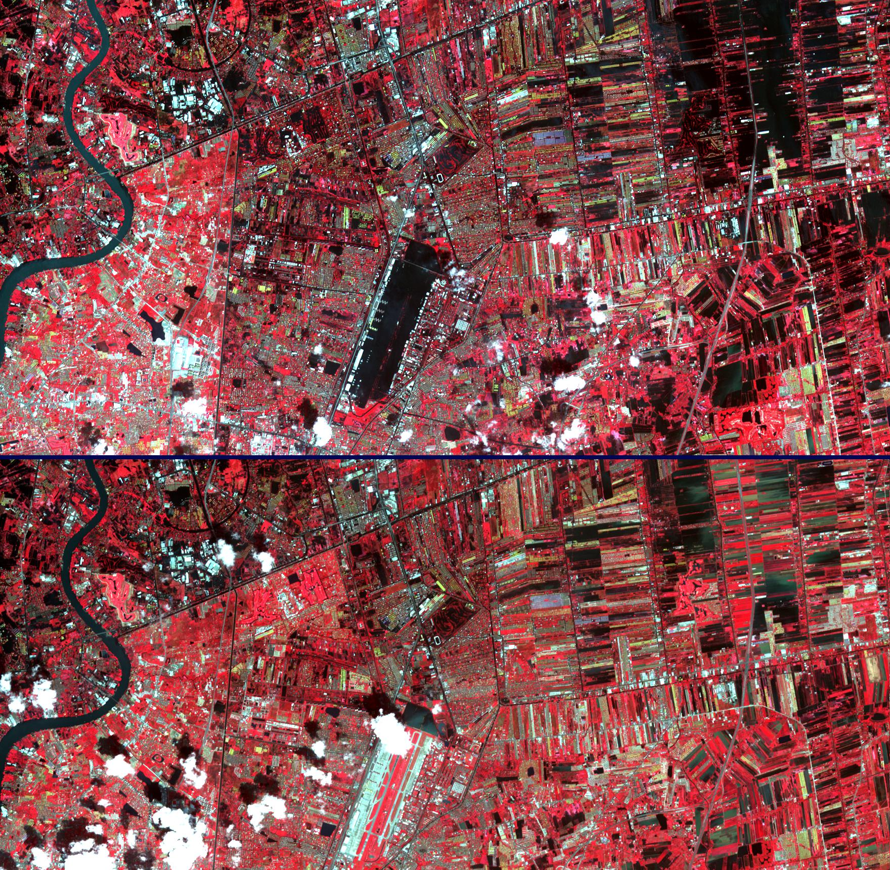
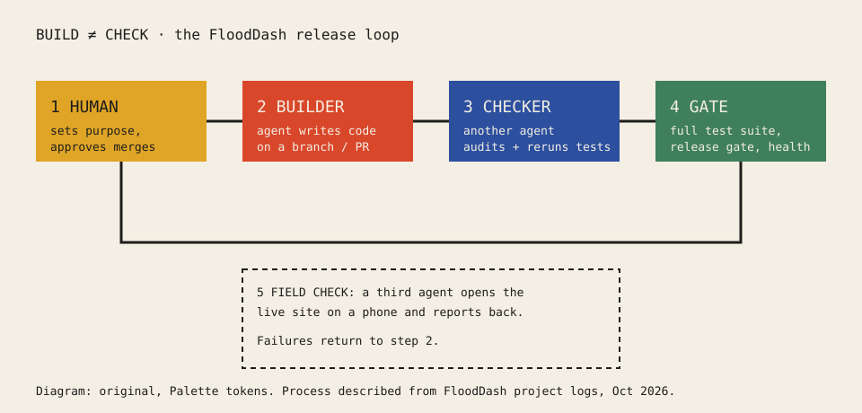

<section lang="en" id="en">

# One Builds, Another Checks: Using Agentic AI to Build a Real Public System — the FloodDash Case

**Non Arkaraprasertkul, PhD** · Thailand's ASCN representative since 2019 · ASCN Working Papers, No. 2 · October 2026 · Draft

**Abstract.** Many people think "vibe coding" means talking to a computer while it does the rest. It does not. In this paper I describe how FloodDash, an independent flood-monitoring website for Thailand, reached a level of reliability that people can lean on during a storm. The short answer is that I treat AI agents like a team of people. One agent builds; a different agent checks. Every change passes a full test suite and a release gate before it goes live, and a third agent checks the live site the way a person would. I also explain the hardware split that keeps the service running. The paper is a single case written by its builder. It shows a working method, not a general proof.

**Keywords:** agentic AI; software quality; smart cities; flood information; human-in-the-loop; Thailand

## 1. Why this matters for cities

Cities wait years for systems. In a 2026 expert session I described how a funding request can take two years to arrive and another two to build, while "people would just keep leaving the city" (Arkaraprasertkul, 2026c). If a small team can build a reliable public tool in weeks, that changes what a city can try. But speed is useless if the tool is wrong. A flood site that gives the wrong advice for the wrong place is worse than no site.

FloodDash (https://flood.nonarkara.org) is my test of that idea. It joins open and agency data on rain, radar and water levels into one view for a place. It is not an official warning system; in Thailand the emergency line is 1784.

*Figure 1. ASTER images of the Chao Phraya flood moving towards Bangkok, 25 October and 1 November 2011. NASA/METI/AIST/Japan Space Systems, and U.S./Japan ASTER Science Team. Public domain. Wikimedia Commons.*

## 2. Vibe coding is not dancing

In May 2026 I recorded a short lesson on how I code with AI. My first point: "If people think vibe coding is about dancing and coding, they're wrong." When I tried it that way, "what I got in return was shitty" (Arkaraprasertkul, 2026b). The work only becomes relaxed after the skill is mature.

My method is to talk to AI the way I would brief a team of humans: break the job into steps, draw the flow, and say who the user is. Then, before shipping, I use what I called my trade secret: "Here's the system, walk through it as if you are human, go through every page, click every button … and report back to me what you like and what you hate." The AI comes back with the buttons that do nothing and the data that never saves. "Okay, thank you. Now fix that" (Arkaraprasertkul, 2026b).

## 3. One builds, another checks

The most important rule is that the agent that writes a change is not the agent that approves it.

I first saw the value of this when two different AI systems reviewed the same plan. One accepted the other's best suggestions and rejected the rest, with reasons (Arkaraprasertkul, 2026a). On FloodDash this is now routine. A coding agent builds a release. A different agent then reads the full diff, reruns the whole test suite on its own and reports what it finds.

One example from October 2026 shows why. An overnight fix by one agent kept retired cameras in the health map forever, because its merge started from the old list. A second agent caught it, replaced it with logic that only looks at current cameras, and also pointed out weak tests (one timed assertion that could flake, one test that copied the logic instead of running it). The first agent re-ran everything, agreed, and shipped the better version (FloodDash project log, 2026).

*Figure 2. The FloodDash release loop. Original diagram by the author.*

## 4. Tests, gates and the field check

Three layers stand between a change and the public:

1. **The full test suite.** In mid-October 2026 the suite had about 2,480 automated tests, and a release needed all of them to pass (FloodDash project log, 2026).
2. **A release gate.** The system checks its own health, data freshness and background workload. A release goes out only when the gate says "ready", and both public addresses are checked after deploy.
3. **A field check.** Another agent opens the live site on a phone and tries real cases, including bad ones, such as a link to a place that does not exist. The page must say it cannot find the place and give no advice for anywhere else.

Audits also find problems that no single change caused. One audit traced three nights of silent server crashes at about 03:30 ICT to two night-time database jobs that collided; the fix was made at both ends and pinned with new tests (FloodDash project log, 2026).

## 5. Branches, not pushes to main

When an agent pushes straight to the main code line, every other piece of work in progress has to be rebased again, and safety fixes wait longer. The rule we settled on is simple: work on a branch, open a pull request, let another agent review it, and let a human approve the merge. The human still decides what goes live.

## 6. The machine split

Reliability is also about hardware. FloodDash runs on a 16 GB MacBook Air (M3) at home that is always on. The heavy work — coding agents, large models, builds — belongs on a 128 GB laptop (M5) that travels and is not always on. Anything that must stay up when the home machine is down goes to the cloud (Cloudflare and GitHub) (Machine roles, 2026). When too many coding sessions ran on the small machine, memory pressure spilled into disk swap and slowed the live service. The fix was not code. It was moving work to the right machine and running one coding session at a time.

## 7. Lessons for ASCN cities

- Treat AI agents as a team with roles, not as a magic box.
- Never let the builder be the only checker.
- Write tests for the mistakes that hurt people most, such as advice shown for the wrong place.
- Keep a human at the merge button.
- Plan hardware and hosting as part of the system.

## 8. Methods and sources

Sources are my own recorded talks and conversations (Otter.ai transcripts, lightly cleaned; meaning unchanged) and FloodDash's internal project records from October 2026: release notes, audit reports from independent coding agents, and a machine-roles plan. Version numbers (4.162.2–4.162.4), test counts (about 2,480), the three nights of ~03:30 crashes, the M3/M5 machine split and the build-then-check rule are as reported in those records on 14–15 October 2026. The author has authorised publishing these project records in this paper.

## 9. Limitations

This is one case, described by the person who built it. The internal figures above are published here with the author's authorisation; a fuller redacted release log may follow later so readers can check more of the trail. I make no claim about how many people use FloodDash or how many losses it prevented. Results will differ with other teams, tools and budgets.

## References

Arkaraprasertkul, N. (2026a, May 17). *Non and Plub on Daoism* [Recorded conversation; Otter.ai transcript]. Author's archive.

Arkaraprasertkul, N. (2026b, May 18). *Vibe coding: three misunderstandings* [Recorded lesson; Otter.ai transcript]. Author's archive.

Arkaraprasertkul, N. (2026c, August 6). *Expert session: Smart cities (TH)* [Recorded interview; Otter.ai transcript]. Author's archive.

FloodDash project log. (2026). *Release and audit notes, versions 4.162.2–4.162.4, 14–15 October 2026* [Unpublished project records].

Machine roles. (2026). *Machine roles: Division of labour, 12 October 2026* [Unpublished internal plan].

## Credits

Figure 1: NASA/METI/AIST/Japan Space Systems, and U.S./Japan ASTER Science Team, "Flooding in Bangkok, Thailand (ASTER)", public domain, https://commons.wikimedia.org/wiki/File:Flooding_in_Bangkok,_Thailand_(ASTER).jpg. Figure 2: original diagram by the author.

</section>

<section lang="th" id="th">

# คนหนึ่งสร้าง อีกคนตรวจ: ใช้ AI แบบเอเจนต์สร้างระบบสาธารณะที่ใช้งานได้จริง กรณีศึกษา FloodDash

**ดร.นน อัครประเสริฐกุล** · ผู้แทนประเทศไทยใน ASCN ตั้งแต่ปี 2562 · ASCN Working Papers ฉบับที่ 2 · ตุลาคม 2569 · ฉบับร่าง

**บทคัดย่อ** หลายคนคิดว่า "vibe coding" คือการพูดกับคอมพิวเตอร์แล้วปล่อยให้มันทำที่เหลือเอง ซึ่งไม่ใช่ บทความนี้เล่าว่า FloodDash เว็บติดตามน้ำท่วมอิสระของไทย ไปถึงระดับที่คนพึ่งพาได้ในวันที่ฝนตกหนักได้อย่างไร คำตอบสั้น ๆ คือผมทำงานกับ AI เหมือนทำงานกับทีมคน เอเจนต์ตัวหนึ่งสร้าง อีกตัวหนึ่งตรวจ ทุกการแก้ไขต้องผ่านชุดทดสอบทั้งหมดและด่านตรวจก่อนปล่อย แล้วเอเจนต์ตัวที่สามเข้าไปลองใช้เว็บจริงแบบที่คนใช้ บทความยังอธิบายการแบ่งงานระหว่างเครื่องที่ทำให้บริการไม่ล่ม นี่คือกรณีเดียวที่เขียนโดยผู้สร้างเอง จึงแสดงวิธีทำงาน ไม่ใช่ข้อพิสูจน์ทั่วไป

**คำสำคัญ:** AI แบบเอเจนต์; คุณภาพซอฟต์แวร์; เมืองอัจฉริยะ; ข้อมูลน้ำท่วม; มนุษย์ในวงจรตัดสินใจ; ประเทศไทย

## 1. ทำไมเรื่องนี้สำคัญกับเมือง

เมืองต้องรอระบบเป็นปี ในเวทีผู้เชี่ยวชาญปี 2569 ผมเล่าว่าคำขอเงินอาจใช้เวลาสองปีกว่าจะได้ แล้วอีกสองปีกว่าจะสร้างเสร็จ ระหว่างนั้นคนก็ย้ายออกจากเมืองไปเรื่อย ๆ (Arkaraprasertkul, 2026c) ถ้าทีมเล็ก ๆ สร้างเครื่องมือสาธารณะที่เชื่อถือได้ภายในไม่กี่สัปดาห์ เมืองก็จะลองอะไรได้มากขึ้น แต่ความเร็วไม่มีความหมายถ้าเครื่องมือผิด เว็บน้ำท่วมที่ให้คำแนะนำผิดพื้นที่ แย่กว่าไม่มีเว็บเลย

FloodDash (https://flood.nonarkara.org) คือการทดลองของผมในเรื่องนี้ เว็บรวมข้อมูลเปิดและข้อมูลจากหน่วยงานเรื่องฝน เรดาร์ และระดับน้ำไว้ในมุมมองเดียวของแต่ละพื้นที่ แต่ไม่ใช่ระบบเตือนภัยทางการ เหตุฉุกเฉินโทร 1784

*ภาพที่ 1 ภาพจาก ASTER แสดงน้ำจากแม่น้ำเจ้าพระยาเคลื่อนเข้าใกล้กรุงเทพฯ วันที่ 25 ตุลาคม และ 1 พฤศจิกายน 2554 โดย NASA/METI/AIST/Japan Space Systems และ U.S./Japan ASTER Science Team สาธารณสมบัติ จาก Wikimedia Commons*

## 2. vibe coding ไม่ใช่การเต้นไปเขียนโค้ดไป

เดือนพฤษภาคม 2569 ผมอัดคลิปสอนสั้น ๆ ว่าผมเขียนโค้ดกับ AI อย่างไร ข้อแรกคือ ถ้าคิดว่า vibe coding คือเต้นไปเขียนโค้ดไป ก็คิดผิด ตอนผมลองแบบนั้น ผลที่ได้แย่มาก (Arkaraprasertkul, 2026b) จะทำงานสบาย ๆ ได้ก็ต่อเมื่อฝีมือถึงแล้ว

วิธีของผมคือคุยกับ AI เหมือนสั่งงานทีมที่เป็นคน แบ่งงานเป็นขั้น วาดลำดับการทำงาน และบอกว่าผู้ใช้คือใคร ก่อนปล่อยระบบ ผมใช้สิ่งที่ผมเรียกว่าเคล็ดลับ คือบอก AI ว่า "นี่คือระบบ ลองใช้มันเหมือนเป็นคน เข้าทุกหน้า กดทุกปุ่ม แล้วรายงานกลับมาว่าชอบอะไร เกลียดอะไร" AI จะกลับมาพร้อมรายการปุ่มที่กดแล้วไม่มีอะไรเกิดขึ้น และข้อมูลที่ไม่ถูกบันทึก จากนั้นก็แค่บอกว่า "ขอบคุณ ทีนี้ไปแก้" (Arkaraprasertkul, 2026b)

## 3. คนหนึ่งสร้าง อีกคนตรวจ

กฎที่สำคัญที่สุดคือ เอเจนต์ที่เขียนการแก้ไข ต้องไม่ใช่เอเจนต์ที่อนุมัติการแก้ไขนั้น

ผมเห็นคุณค่าของกฎนี้ครั้งแรกตอนให้ AI สองระบบรีวิวแผนเดียวกัน ระบบหนึ่งรับข้อเสนอดี ๆ ของอีกระบบ และปฏิเสธที่เหลือพร้อมเหตุผล (Arkaraprasertkul, 2026a) ใน FloodDash ตอนนี้ทำแบบนี้เป็นปกติ เอเจนต์เขียนโค้ดตัวหนึ่งสร้างรุ่นใหม่ อีกตัวหนึ่งอ่านการเปลี่ยนแปลงทั้งหมด รันชุดทดสอบทั้งชุดเอง แล้วรายงานสิ่งที่พบ

ตัวอย่างเมื่อตุลาคม 2569 แสดงให้เห็นว่าทำไม การแก้ไขข้ามคืนของเอเจนต์ตัวหนึ่งทำให้กล้องที่เลิกใช้แล้วค้างอยู่ในแผนที่สถานะตลอดไป เพราะเริ่มรวมข้อมูลจากรายการเก่า เอเจนต์ตัวที่สองจับได้ เปลี่ยนให้ดูเฉพาะกล้องที่ยังใช้งาน และยังชี้ว่าการทดสอบบางตัวอ่อน (ตัวหนึ่งจับเวลาแล้วอาจผิดพลาดแบบสุ่ม อีกตัวคัดลอกโค้ดมาแทนที่จะเรียกใช้จริง) เอเจนต์ตัวแรกรันทุกอย่างใหม่ เห็นด้วย และปล่อยรุ่นที่ดีกว่า (FloodDash project log, 2026)

*ภาพที่ 2 วงจรการปล่อยรุ่นของ FloodDash แผนภาพต้นฉบับโดยผู้เขียน*

## 4. ชุดทดสอบ ด่านตรวจ และการลองใช้จริง

ระหว่างการแก้ไขกับประชาชน มีสามชั้น

1. **ชุดทดสอบทั้งหมด** กลางเดือนตุลาคม 2569 มีการทดสอบอัตโนมัติราว 2,480 รายการ และต้องผ่านทั้งหมดจึงปล่อยได้ (FloodDash project log, 2026)
2. **ด่านตรวจก่อนปล่อย** ระบบตรวจสุขภาพตัวเอง ความสดของข้อมูล และงานเบื้องหลัง จะปล่อยได้เมื่อด่านบอกว่า "พร้อม" และหลังปล่อยต้องตรวจทั้งสองที่อยู่สาธารณะ
3. **การลองใช้จริง** เอเจนต์อีกตัวเปิดเว็บจริงบนโทรศัพท์และลองกรณีจริง รวมถึงกรณีผิด ๆ เช่นลิงก์ไปยังสถานที่ที่ไม่มีอยู่ หน้าเว็บต้องบอกว่าหาสถานที่ไม่พบ และต้องไม่แสดงคำแนะนำของที่อื่น

การตรวจสอบยังพบปัญหาที่ไม่ได้มาจากการแก้ไขครั้งใดครั้งหนึ่ง ครั้งหนึ่งพบว่าเซิร์ฟเวอร์ดับเงียบสามคืนติดกันราวเวลา 03:30 น. เพราะงานฐานข้อมูลสองงานตอนกลางคืนชนกัน จึงแก้ทั้งสองฝั่งและเพิ่มการทดสอบกันไว้ (FloodDash project log, 2026)

## 5. ทำงานบนกิ่ง ไม่ดันเข้าสายหลักตรง ๆ

เมื่อเอเจนต์ดันโค้ดเข้าสายหลัก (main) ตรง ๆ งานอื่นที่ค้างอยู่ต้องปรับฐานใหม่ทั้งหมด และการแก้เรื่องความปลอดภัยก็ต้องรอนานขึ้น กฎที่เราตกลงกันจึงง่ายมาก ทำงานบนกิ่ง (branch) เปิดคำขอรวมโค้ด (pull request) ให้เอเจนต์อีกตัวรีวิว แล้วให้คนกดอนุมัติ คนยังเป็นผู้ตัดสินว่าอะไรจะขึ้นจริง

## 6. การแบ่งงานระหว่างเครื่อง

ความเสถียรเป็นเรื่องฮาร์ดแวร์ด้วย FloodDash รันบน MacBook Air (M3) แรม 16 GB ที่บ้านซึ่งเปิดตลอดเวลา งานหนักอย่างเอเจนต์เขียนโค้ด โมเดลขนาดใหญ่ และการ build ควรอยู่บนแล็ปท็อปแรม 128 GB (M5) ที่พกไปไหนมาไหนและไม่ได้เปิดตลอด ส่วนอะไรที่ต้องออนไลน์แม้เครื่องที่บ้านดับ ให้ไปอยู่บนคลาวด์ (Cloudflare และ GitHub) (Machine roles, 2026) เมื่อมีงานเขียนโค้ดหลายงานบนเครื่องเล็กพร้อมกัน หน่วยความจำล้นไปใช้ดิสก์แทน และทำให้บริการจริงช้าลง ทางแก้ไม่ใช่โค้ด แต่คือย้ายงานไปเครื่องที่เหมาะ และเขียนโค้ดทีละงาน

## 7. บทเรียนสำหรับเมืองใน ASCN

- มอง AI เป็นทีมที่มีบทบาท ไม่ใช่กล่องวิเศษ
- อย่าให้ผู้สร้างเป็นผู้ตรวจเพียงคนเดียว
- เขียนการทดสอบสำหรับความผิดพลาดที่ทำร้ายคนมากที่สุด เช่นแสดงคำแนะนำผิดพื้นที่
- ให้คนเป็นผู้กดปุ่มรวมโค้ดเสมอ
- วางแผนฮาร์ดแวร์และที่ตั้งระบบเป็นส่วนหนึ่งของระบบ

## 8. วิธีการและแหล่งข้อมูล

แหล่งข้อมูลคือการบรรยายและบทสนทนาของผมที่บันทึกไว้ (ถอดความด้วย Otter.ai ขัดเกลาเล็กน้อยโดยไม่เปลี่ยนความหมาย ข้อความอ้างในฉบับภาษาไทยแปลจากต้นฉบับ) และบันทึกภายในของโครงการ FloodDash เดือนตุลาคม 2569 ได้แก่ บันทึกการปล่อยรุ่น รายงานตรวจสอบจากเอเจนต์เขียนโค้ดอิสระ และแผนแบ่งบทบาทเครื่อง เลขรุ่น (4.162.2–4.162.4) จำนวนการทดสอบ (ราว 2,480) การดับราว 03:30 สามคืน การแบ่งเครื่อง M3/M5 และกฎสร้างแล้วตรวจ เป็นไปตามบันทึกวันที่ 14–15 ตุลาคม 2569 ผู้เขียนได้อนุญาตให้เผยแพร่บันทึกโครงการเหล่านี้ในบทความนี้

## 9. ข้อจำกัด

นี่เป็นกรณีเดียว เล่าโดยผู้สร้างเอง ตัวเลขภายในข้างต้นเผยแพร่ในที่นี้โดยได้รับอนุญาตจากผู้เขียน บันทึกการปล่อยรุ่นแบบตัดข้อมูลบางส่วนอาจตามมาในภายหลังเพื่อให้ผู้อ่านตรวจสอบเส้นทางได้มากขึ้น บทความนี้ไม่อ้างจำนวนผู้ใช้หรือความเสียหายที่ป้องกันได้ และผลลัพธ์อาจต่างไปตามทีม เครื่องมือ และงบประมาณ

## เอกสารอ้างอิง

ดูรายการอ้างอิงในฉบับภาษาอังกฤษ (รูปแบบ APA 7)

</section>
