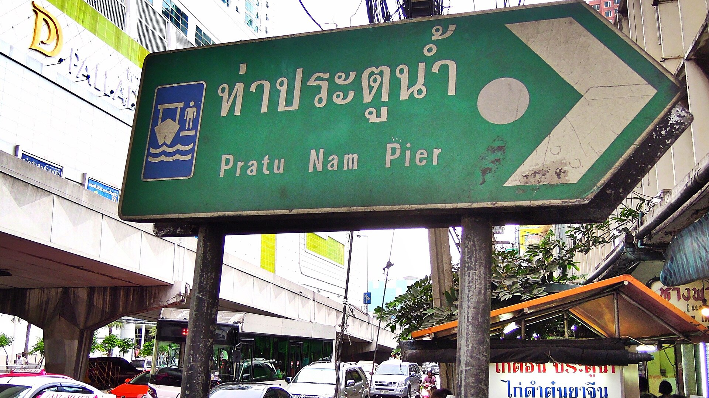
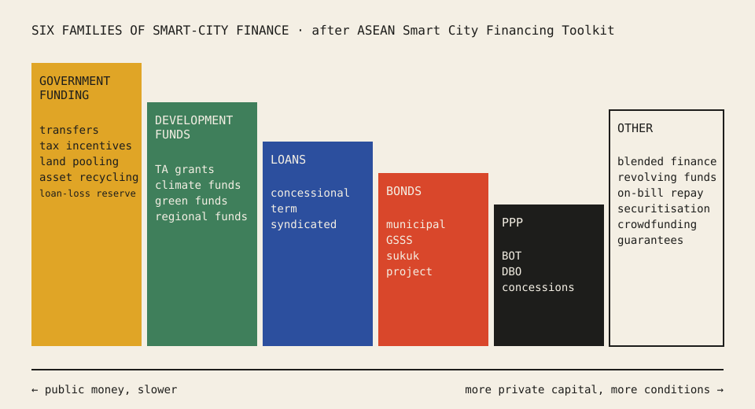

<section lang="en" id="en">

# Stop Waiting for the Budget: A Plain Guide to Smart-City Finance in ASEAN

**Non Arkaraprasertkul, PhD** · Thailand's ASCN representative since 2019 · ASCN Working Papers, No. 3 · October 2026 · Draft

**Abstract.** Most smart-city projects in ASEAN are paid for by national budgets, and most cities simply wait for that money. I argue that waiting has a cost that rarely appears in any plan: people and businesses leave while the city waits. Using the ASEAN Smart City Financing Toolkit, I lay out the six families of finance a city can use, in plain words, and suggest how a city officer can match a project to a source. The descriptions of instruments come from the Toolkit and are credited to it. The argument about the cost of waiting is mine, drawn from recorded talks. This is a guide, not financial or legal advice.

**Keywords:** municipal finance; public–private partnership; smart cities; ASEAN; bonds; blended finance

## 1. The cost of waiting

In Thailand, most cities, municipalities and agencies "are just waiting for government funding," and public–private partnership (PPP) schemes "are not that popular" (Arkaraprasertkul, 2026b). I want to change that.

Here is the problem in one example. A city floods every year. The money for flood works arrives in two years, and building takes two more. "Can you imagine those five years? … People would just keep leaving the city. Manufacturing would keep leaving the city" (Arkaraprasertkul, 2026b). There is an opportunity cost to waiting. A mayor's term is about four years, so waiting can feel safe for the office holder, but not for the city.

I said the same to UN-Habitat colleagues: "If you wait five more years of funding, your city might not have people [left]" (Arkaraprasertkul, 2026a). The answer is not to stop using the national budget. It is to know the other doors.

*Figure 1. Pratu Nam Pier, Bangkok, 2012. Photo: David McKelvey, CC BY 2.0, via Wikimedia Commons. Canal boats are an example of public service that mixes public assets and private operators.*

## 2. The map: six families of finance

The ASEAN Smart City Financing Toolkit, developed with the Australian Government through the Aus4ASEAN Futures Initiative, sorts instruments into six families (ASEAN, 2024e). I summarise each below in plain words.

*Figure 2. The six instrument families in the ASEAN Smart City Financing Toolkit. Original diagram by the author; the left-to-right order is my own simplification, not the Toolkit's.*

**2.1 Government funding.** Money from national or state budgets. The Toolkit calls national government transfers "the most frequently used funding model for smart city projects in ASEAN" (ASEAN, 2024j). It stresses transparent public financial management and cites IMF research that an average country loses up to 30% of the value of public investment through inefficiency (ASEAN, 2024j). The same family includes land pooling, where landowners give part of their land for roads and parks and get back a smaller but more valuable plot (ASEAN, 2024h).

**2.2 Development funds.** Grants and funds from development partners. Technical assistance grants pay for skills and specialist services that help a city design and run complex projects (ASEAN, 2024k). For many smaller ASCN cities, this is the realistic first step.

**2.3 Loans.** Concessional loans have better-than-market terms, such as lower interest or a grace period, and are often given by development finance institutions. The Toolkit notes they can act as a bridge to attract larger private money later, and that a city's creditworthiness matters (ASEAN, 2024c).

**2.4 Bonds.** A municipal bond lets a local government borrow from investors for a public project. It needs a legal framework that allows borrowing and helps if the city has a good credit rating (ASEAN, 2024i). Green, social and sustainability bonds tie the money to environmental or social outcomes and should follow recognised standards, such as ASEAN's standards based on ICMA principles (ASEAN, 2024g).

**2.5 Public–private partnership (PPP).** A long-term contract in which a private partner builds or runs a public asset and carries part of the risk. In build–operate–transfer (BOT), the private side finances, builds and runs the system for a period, then hands it to the government (ASEAN, 2024b).

**2.6 Other mechanisms.** These include blended finance, where public or philanthropic money takes the first risk so private investors can join (ASEAN, 2024a), and crowdfunding, where many citizens give small amounts. The Toolkit notes crowdfunding also tells a city what residents care about (ASEAN, 2024d).

## 3. When PPP makes sense

PPP is not a magic word. In a 2025 meeting I put it this way: "Sometimes it has to be PPP … because sometimes the private sector couldn't justify investing … it doesn't look good in terms of feasibility study." The government may then offer land at a nominal price in exchange for public benefits (Arkaraprasertkul, 2025). In other words, PPP works when both sides get something they could not get alone, and the deal says so in writing.

## 4. A simple matching guide

Use the 4P filter first (see Working Paper No. 1). Then ask:

1. **Is it small and urgent?** Start with what you can fund now: existing budget, a technical assistance grant, or a small pilot.
2. **Does it earn revenue?** Fees or savings open the door to PPP, loans or project bonds.
3. **Does it have a clear green or social outcome?** Consider GSSS bonds or climate funds.
4. **Is the risk too high for private money alone?** Look at blended finance or guarantees.
5. **Do citizens care enough to chip in?** Crowdfunding can test that, and the data is useful too.

The Toolkit's FIRST quiz (Financial Instrument Recommendation and Selection Tool) helps officials explore options for a specific project (ASEAN, 2024f).

## 5. Methods and sources

Instrument descriptions are summarised from the public pages of the ASEAN Smart City Financing Toolkit, read on 15 October 2026. Quotations of my own words come from recorded meetings and talks (Otter.ai transcripts, lightly cleaned; meaning unchanged). No figures in this paper come from my transcripts.

## 6. Limitations

This paper is a plain-language guide. It does not assess the law of any member state, and whether a city can borrow or issue bonds depends on national law. No invented deals appear here. Live ASCN case studies will be added as they are cleared for publication; the Toolkit's case-study library remains the next public source to use.

## References

All ASEAN pages retrieved October 15, 2026.

Arkaraprasertkul, N. (2025, October 14). *Smart city collaboration meeting* [Recorded meeting; Otter.ai transcript]. Author's archive.

Arkaraprasertkul, N. (2026a, March 4). *UN-Habitat meeting* [Recorded meeting; Otter.ai transcript]. Author's archive.

Arkaraprasertkul, N. (2026b, August 6). *Expert session: Smart cities (TH)* [Recorded interview; Otter.ai transcript]. Author's archive.

ASEAN. (2024a). *Blended finance vehicles*. ASEAN Smart City Financing Toolkit. https://smartcitytoolkit.asean.org/financial-instrument/blended-finance-vehicles/

ASEAN. (2024b). *Build-operate-transfer (BOT)*. ASEAN Smart City Financing Toolkit. https://smartcitytoolkit.asean.org/financial-instrument/build-operate-transfer-bot/

ASEAN. (2024c). *Concessional loan*. ASEAN Smart City Financing Toolkit. https://smartcitytoolkit.asean.org/financial-instrument/concessional-loan/

ASEAN. (2024d). *Crowdfunding*. ASEAN Smart City Financing Toolkit. https://smartcitytoolkit.asean.org/financial-instrument/crowdfunding/

ASEAN. (2024e). *Financial instruments*. ASEAN Smart City Financing Toolkit. https://smartcitytoolkit.asean.org/financial-instruments/

ASEAN. (2024f). *FIRST: Financial instrument recommendation and selection tool*. ASEAN Smart City Financing Toolkit. https://smartcitytoolkit.asean.org/first/

ASEAN. (2024g). *Green, social, sustainable and sustainability-linked bonds (GSSS bonds)*. ASEAN Smart City Financing Toolkit. https://smartcitytoolkit.asean.org/financial-instrument/green-social-sustainable-and-sustainability-linked-bonds-gsss-bonds/

ASEAN. (2024h). *Land pooling*. ASEAN Smart City Financing Toolkit. https://smartcitytoolkit.asean.org/financial-instrument/land-pooling/

ASEAN. (2024i). *Municipal bonds*. ASEAN Smart City Financing Toolkit. https://smartcitytoolkit.asean.org/financial-instrument/municipal-bonds/

ASEAN. (2024j). *National government transfers*. ASEAN Smart City Financing Toolkit. https://smartcitytoolkit.asean.org/financial-instrument/national-government-transfers/

ASEAN. (2024k). *Technical assistance grants*. ASEAN Smart City Financing Toolkit. https://smartcitytoolkit.asean.org/financial-instrument/technical-assistance-grants/

## Credits

Instrument categories and definitions: ASEAN Smart City Financing Toolkit (© 2024 ASEAN), developed in partnership with the Australian Government through the Aus4ASEAN Futures Initiative; summarised and linked, not copied. No Toolkit images are reproduced. Figure 1: David McKelvey, "Pratu Nam Pier, Bangkok, Thailand", 2012, CC BY 2.0, https://commons.wikimedia.org/wiki/File:Pratu_Nam_Pier,_Bangkok,_Thailand_(6906983490).jpg. Figure 2: original diagram by the author.

</section>

<section lang="th" id="th">

# เลิกรองบประมาณ: คู่มือภาษาง่ายเรื่องการเงินเมืองอัจฉริยะในอาเซียน

**ดร.นน อัครประเสริฐกุล** · ผู้แทนประเทศไทยใน ASCN ตั้งแต่ปี 2562 · ASCN Working Papers ฉบับที่ 3 · ตุลาคม 2569 · ฉบับร่าง

**บทคัดย่อ** โครงการเมืองอัจฉริยะส่วนใหญ่ในอาเซียนใช้งบประมาณจากส่วนกลาง และเมืองส่วนใหญ่ก็แค่รอเงินก้อนนั้น ผมเห็นว่าการรอมีต้นทุนที่แทบไม่เคยอยู่ในแผนใดเลย คือคนและธุรกิจย้ายออกระหว่างที่เมืองรอ บทความนี้ใช้ ASEAN Smart City Financing Toolkit อธิบายแหล่งเงินหกกลุ่มที่เมืองเลือกใช้ได้ด้วยภาษาง่าย ๆ และเสนอวิธีจับคู่โครงการกับแหล่งเงิน คำอธิบายเครื่องมือการเงินมาจาก Toolkit และให้เครดิตไว้ ส่วนข้อโต้แย้งเรื่องต้นทุนของการรอเป็นของผมเอง จากการบรรยายที่บันทึกไว้ บทความนี้เป็นคู่มือ ไม่ใช่คำแนะนำทางการเงินหรือกฎหมาย

**คำสำคัญ:** การเงินท้องถิ่น; การร่วมลงทุนรัฐและเอกชน (PPP); เมืองอัจฉริยะ; อาเซียน; พันธบัตร; การเงินแบบผสม

## 1. ต้นทุนของการรอ

ในประเทศไทย เมือง เทศบาล และหน่วยงานส่วนใหญ่ "รอแต่งบจากรัฐบาล" และการร่วมลงทุนรัฐกับเอกชน (PPP) "ยังไม่ค่อยเป็นที่นิยม" (Arkaraprasertkul, 2026b) ผมอยากเปลี่ยนเรื่องนี้

ลองดูตัวอย่าง เมืองหนึ่งน้ำท่วมทุกปี เงินสำหรับงานป้องกันน้ำท่วมมาถึงในอีกสองปี และใช้เวลาก่อสร้างอีกสองปี "ลองนึกถึงห้าปีนั้นดู คนก็จะย้ายออกจากเมืองไปเรื่อย ๆ โรงงานก็ย้ายออกไปเรื่อย ๆ" (Arkaraprasertkul, 2026b) การรอมีค่าเสียโอกาส วาระของนายกเทศมนตรีราวสี่ปี การรอจึงอาจดูปลอดภัยสำหรับผู้ดำรงตำแหน่ง แต่ไม่ปลอดภัยสำหรับเมือง

ผมพูดแบบเดียวกันกับเพื่อนร่วมงานที่ UN-Habitat ว่า ถ้ารองบอีกห้าปี เมืองอาจไม่เหลือคนแล้ว (Arkaraprasertkul, 2026a) ทางออกไม่ใช่เลิกใช้งบส่วนกลาง แต่คือรู้จักประตูอื่น ๆ ด้วย

*ภาพที่ 1 ท่าเรือประตูน้ำ กรุงเทพฯ ปี 2555 ภาพโดย David McKelvey สัญญาอนุญาต CC BY 2.0 จาก Wikimedia Commons เรือคลองเป็นตัวอย่างบริการสาธารณะที่ผสมทรัพย์สินของรัฐกับผู้ให้บริการเอกชน*

## 2. แผนที่: แหล่งเงินหกกลุ่ม

ASEAN Smart City Financing Toolkit ซึ่งพัฒนาร่วมกับรัฐบาลออสเตรเลียผ่านโครงการ Aus4ASEAN Futures Initiative แบ่งเครื่องมือการเงินเป็นหกกลุ่ม (ASEAN, 2024e) สรุปด้วยภาษาง่าย ๆ ได้ดังนี้

*ภาพที่ 2 เครื่องมือการเงินหกกลุ่มตาม ASEAN Smart City Financing Toolkit แผนภาพต้นฉบับโดยผู้เขียน การเรียงจากซ้ายไปขวาเป็นการสรุปอย่างง่ายของผู้เขียนเอง ไม่ใช่ของ Toolkit*

**2.1 งบประมาณภาครัฐ** เงินจากงบประมาณส่วนกลางหรือรัฐ Toolkit ระบุว่าเงินโอนจากรัฐบาลกลางเป็น "รูปแบบที่ใช้บ่อยที่สุดสำหรับโครงการเมืองอัจฉริยะในอาเซียน" (ASEAN, 2024j) และเน้นการบริหารการคลังที่โปร่งใส โดยอ้างงานวิจัยของ IMF ว่าโดยเฉลี่ยประเทศหนึ่งสูญเสียมูลค่าการลงทุนภาครัฐได้ถึง 30% จากความไม่มีประสิทธิภาพ (ASEAN, 2024j) กลุ่มนี้ยังรวมการจัดรูปที่ดิน ซึ่งเจ้าของที่ดินแบ่งที่ส่วนหนึ่งให้ทำถนนและสวน แล้วได้ที่ดินคืนแปลงเล็กลงแต่มีมูลค่าสูงขึ้น (ASEAN, 2024h)

**2.2 กองทุนเพื่อการพัฒนา** เงินให้เปล่าและกองทุนจากหน่วยงานพัฒนา ทุนความช่วยเหลือทางวิชาการจ่ายค่าทักษะและผู้เชี่ยวชาญที่ช่วยให้เมืองออกแบบและดำเนินโครงการที่ซับซ้อนได้ (ASEAN, 2024k) สำหรับเมืองเล็กหลายแห่งใน ASCN นี่คือก้าวแรกที่เป็นไปได้จริง

**2.3 เงินกู้** เงินกู้ผ่อนปรนมีเงื่อนไขดีกว่าตลาด เช่นดอกเบี้ยต่ำหรือมีช่วงปลอดชำระหนี้ มักให้โดยสถาบันการเงินเพื่อการพัฒนา Toolkit ระบุว่าเงินกู้แบบนี้ช่วยเป็นสะพานดึงเงินเอกชนก้อนใหญ่ในภายหลังได้ และความน่าเชื่อถือทางการเงินของเมืองมีความสำคัญ (ASEAN, 2024c)

**2.4 พันธบัตร** พันธบัตรท้องถิ่นทำให้รัฐบาลท้องถิ่นกู้เงินจากนักลงทุนมาทำโครงการสาธารณะได้ ต้องมีกฎหมายที่อนุญาตให้กู้ และจะง่ายขึ้นถ้าเมืองมีอันดับความน่าเชื่อถือดี (ASEAN, 2024i) พันธบัตรสีเขียว พันธบัตรเพื่อสังคม และพันธบัตรเพื่อความยั่งยืน ผูกเงินไว้กับผลลัพธ์ด้านสิ่งแวดล้อมหรือสังคม และควรทำตามมาตรฐานที่ยอมรับ เช่นมาตรฐานของอาเซียนที่อิงหลักการของ ICMA (ASEAN, 2024g)

**2.5 การร่วมลงทุนรัฐและเอกชน (PPP)** สัญญาระยะยาวที่เอกชนสร้างหรือบริหารทรัพย์สินสาธารณะ และรับความเสี่ยงบางส่วน แบบสร้าง–ดำเนินการ–โอน (BOT) เอกชนลงทุน สร้าง และดำเนินระบบตามระยะเวลาที่ตกลง แล้วโอนให้รัฐ (ASEAN, 2024b)

**2.6 กลไกอื่น ๆ** เช่น การเงินแบบผสม ที่เงินรัฐหรือเงินการกุศลรับความเสี่ยงก่อน เพื่อให้นักลงทุนเอกชนเข้ามาร่วมได้ (ASEAN, 2024a) และการระดมทุนจากประชาชน ที่คนจำนวนมากร่วมกันคนละเล็กละน้อย Toolkit ระบุว่าการระดมทุนแบบนี้ยังบอกเมืองด้วยว่าผู้อยู่อาศัยให้ความสำคัญกับอะไร (ASEAN, 2024d)

## 3. เมื่อไร PPP จึงสมเหตุสมผล

PPP ไม่ใช่คาถาวิเศษ ในการประชุมปี 2568 ผมอธิบายว่า บางครั้งต้องเป็น PPP เพราะเอกชนลงทุนเองไม่คุ้ม ผลการศึกษาความเป็นไปได้ไม่ผ่าน รัฐจึงอาจให้ที่ดินในราคาต่ำเป็นการแลกกับประโยชน์สาธารณะ (Arkaraprasertkul, 2025) พูดง่าย ๆ คือ PPP ได้ผลเมื่อทั้งสองฝ่ายได้สิ่งที่ทำคนเดียวไม่ได้ และเขียนไว้ชัดในสัญญา

## 4. วิธีจับคู่อย่างง่าย

ใช้ตัวกรอง 4P ก่อน (ดู Working Paper ฉบับที่ 1) แล้วถามต่อว่า

1. **โครงการเล็กและเร่งด่วนไหม** เริ่มจากสิ่งที่หาเงินได้ตอนนี้ เช่นงบที่มีอยู่ ทุนความช่วยเหลือทางวิชาการ หรือโครงการนำร่องเล็ก ๆ
2. **โครงการสร้างรายได้ไหม** ค่าบริการหรือเงินที่ประหยัดได้ เปิดทางสู่ PPP เงินกู้ หรือพันธบัตรโครงการ
3. **มีผลลัพธ์ด้านสิ่งแวดล้อมหรือสังคมชัดเจนไหม** พิจารณาพันธบัตร GSSS หรือกองทุนด้านสภาพภูมิอากาศ
4. **ความเสี่ยงสูงเกินกว่าที่เอกชนจะรับคนเดียวไหม** ดูการเงินแบบผสมหรือการค้ำประกัน
5. **ประชาชนสนใจมากพอจะร่วมลงขันไหม** การระดมทุนจากประชาชนช่วยทดสอบได้ และยังได้ข้อมูลที่มีประโยชน์ด้วย

แบบทดสอบ FIRST (Financial Instrument Recommendation and Selection Tool) ใน Toolkit ช่วยให้เจ้าหน้าที่สำรวจทางเลือกสำหรับโครงการของตัวเองได้ (ASEAN, 2024f)

## 5. วิธีการและแหล่งข้อมูล

คำอธิบายเครื่องมือการเงินสรุปจากหน้าเว็บสาธารณะของ ASEAN Smart City Financing Toolkit ที่อ่านเมื่อ 15 ตุลาคม 2569 ข้อความที่อ้างคำพูดของผมมาจากการประชุมและการบรรยายที่บันทึกไว้ (ถอดความด้วย Otter.ai ขัดเกลาเล็กน้อยโดยไม่เปลี่ยนความหมาย ข้อความในฉบับภาษาไทยแปลจากต้นฉบับ) ไม่มีตัวเลขใดในบทความนี้มาจากบันทึกการบรรยายของผม

## 6. ข้อจำกัด

บทความนี้เป็นคู่มือภาษาง่าย ไม่ได้วิเคราะห์กฎหมายของประเทศสมาชิกใด เมืองจะกู้เงินหรือออกพันธบัตรได้หรือไม่ขึ้นกับกฎหมายของแต่ละประเทศ ไม่มีดีลที่แต่งขึ้นในบทความนี้ กรณีศึกษา ASCN จริงจะเพิ่มเมื่อได้รับอนุญาตให้เผยแพร่ คลังกรณีศึกษาของ Toolkit ยังเป็นแหล่งสาธารณะถัดไปที่ควรใช้

## เอกสารอ้างอิง

ดูรายการอ้างอิงในฉบับภาษาอังกฤษ (รูปแบบ APA 7)

</section>
